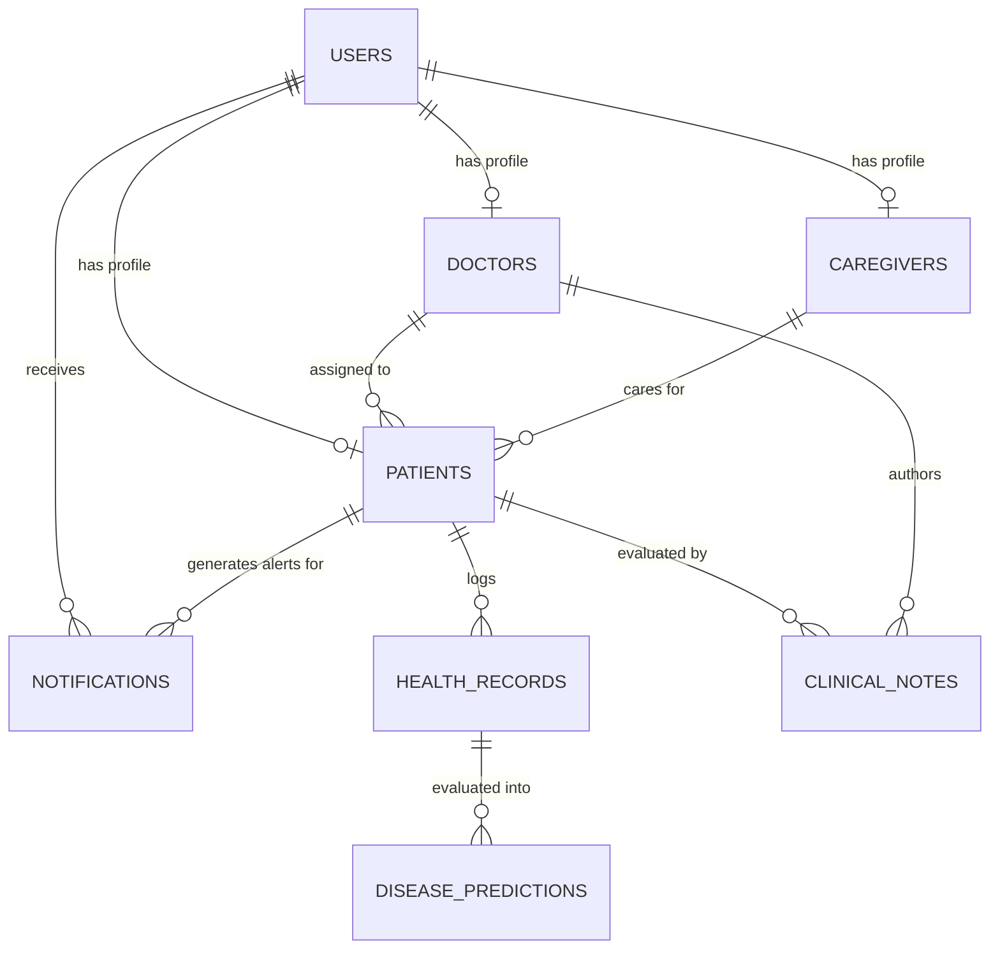
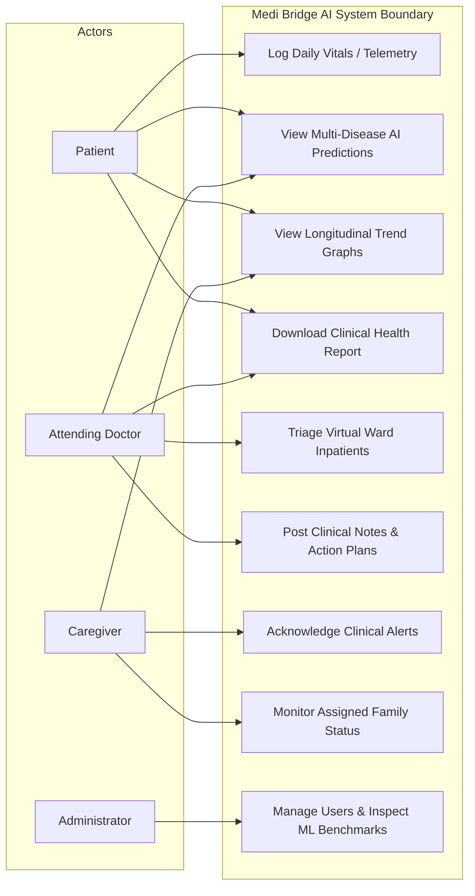
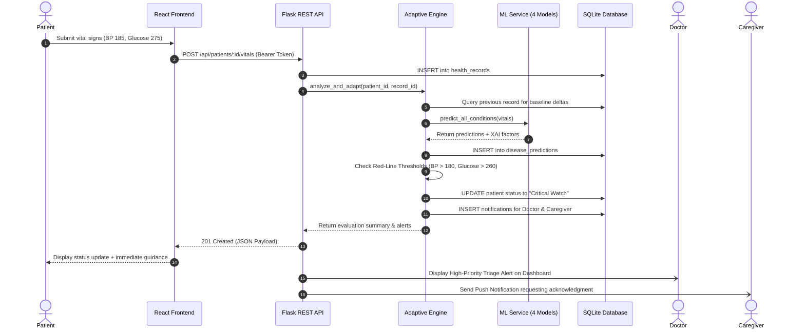

# Academic Project Report
## Medi Bridge AI: An Adaptive AI-Driven Virtual Wards for Enhanced Monitoring of Diabetes, Chronic Kidney Disease, Hypertension, and Cardiovascular Conditions

---

### Table of Contents
1. **Abstract**
2. **Problem Statement**
3. **Analysis of Existing Systems vs. Proposed System**
4. **Project Objectives**
5. **System Architecture & Design**
6. **Module Descriptions**
7. **Technology Stack**
8. **Database Design & Entity-Relationship Modeling**
9. **UML Diagrams & System Dynamics**
10. **Data Flow Diagrams (DFD Level 0 & Level 1)**
11. **Machine Learning Pipeline & Clinical Benchmarks**
12. **Explainable AI (XAI) Implementation**
13. **Adaptive Monitoring & Safety Threshold Logic**
14. **Testing, Verification & Results**
15. **System Limitations**
16. **Future Enhancements & Research Directions**
17. **Conclusion**
18. **References & Clinical Citations**

---

### 1. Abstract
The increasing global prevalence of comorbid chronic illnesses—specifically Type-2 Diabetes Mellitus, Chronic Kidney Disease (CKD), Essential Hypertension, and Cardiovascular Disease (CVD)—presents an unsustainable burden on centralized inpatient healthcare facilities. Conventional outpatient models rely on sporadic physical consultations, often failing to detect sub-acute physiological deterioration prior to acute medical crises. 

This project presents **Medi Bridge AI**, an adaptive, machine learning-driven virtual ward healthcare platform designed for continuous, multi-stakeholder remote patient management. Medi Bridge AI unifies patients, attending physicians, and informal caregivers within a collaborative digital ecosystem. The system features four distinct machine learning classification models trained on established clinical benchmark distributions (Pima/NHANES Diabetes, UCI Chronic Kidney Disease, AHA/ACC Hypertension, and Cleveland Heart Disease). 

Incoming longitudinal patient telemetry is continuously evaluated by an adaptive monitoring engine that calculates biometric deltas against historical baselines, dynamically recalculates cross-disease risk trajectories, evaluates clinically calibrated red-line safety thresholds, and orchestrates role-based automated alert dispatch. Furthermore, an integrated Explainable AI (XAI) feature importance module translates high-dimensional mathematical model weights into interpretable, plain-language insights for patients and structured physiological risk factors for clinicians. Evaluated on test benchmarks, the models achieve classification accuracies ranging from 94.1% to 97.1% and ROC-AUC scores exceeding 0.99, demonstrating the viability of intelligent virtual wards for proactive chronic disease surveillance.

---

### 2. Problem Statement
Chronic diseases represent over 70% of global mortality, with cardiovascular conditions, diabetes, and renal impairment exhibiting pronounced pathophysiological syndemics. In traditional healthcare systems:
1. **Data Fragmentation & Lag**: Vital signs are captured intermittently during clinic visits (often weeks or months apart), obscuring rapid trajectory shifts (e.g., escalating systolic blood pressure accelerating glomerular filtration decline).
2. **Inpatient Ward Overcrowding**: Non-critical patients occupy high-cost inpatient hospital beds primarily for observation and periodic vital checks.
3. **Caregiver Disconnection**: Informal caregivers, who provide over 80% of day-to-day patient support, lack transparent, real-time access to clinical status and deterioration warnings.
4. **Black-Box AI Skepticism**: Emerging clinical AI models frequently function as opaque "black boxes," providing uncalibrated probability figures that foster distrust among doctors and induce anxiety in patients.

There is a critical requirement for an integrated, explainable, and adaptive virtual ward platform that bridges patients, physicians, and caregivers through continuous monitoring, proactive alerting, and transparent decision-support.

---

### 3. Analysis of Existing Systems vs. Proposed System

| Dimension | Conventional Clinic Model | Commercial Wearable Apps | Proposed: Medi Bridge AI Virtual Ward |
| :--- | :--- | :--- | :--- |
| **Monitoring Paradigm** | Episodic (at clinic visits) | Passive fitness tracking | Continuous, longitudinal clinical telemetry |
| **Comorbidity Support** | Single-disease silos | General wellness metrics | Integrated cross-analysis: Diabetes, CKD, HTN, CVD |
| **AI Decision Support** | None / Manual guidelines | Simple threshold notifications | 4 Calibrated Random Forest ML models with ROC-AUC > 0.99 |
| **Explainable AI (XAI)** | N/A | None | Real-time feature importance breakdown & plain-English synthesis |
| **Stakeholder Collaboration** | Isolated patient visits | Patient-only interface | Coordinated tri-role ecosystem (Patient, Doctor, Caregiver) |
| **Dynamic Adaptability** | Static assessments | Static threshold alarms | Adaptive engine: delta tracking & risk escalation triggers |
| **Clinical Reporting** | Delayed paper records | Raw CSV/PDF exports | Standardized Clinical Summary with physician action plans |

---

### 4. Project Objectives
The primary technical and clinical objectives of the Medi Bridge AI project include:
1. **Multi-Role Authentication & Access Control**: Secure, role-based JWT authentication protecting Patient, Attending Physician, Informal Caregiver, and System Administrator interfaces.
2. **Four Disease-Specific ML Models**: Training, validation, and serialization of four specialized Scikit-Learn pipelines for Diabetes, CKD, Hypertension, and Cardiovascular conditions.
3. **Explainable AI (XAI)**: Integration of a feature attribution engine that computes percentage contribution weights and natural-language summaries for every prediction.
4. **Adaptive Virtual Ward Engine**: Automated delta analysis comparing newly ingested vitals against historical moving baselines to escalate virtual ward triage status (`Stable`, `Requires Review`, `Critical Watch`).
5. **Multi-Channel Alert Dispatch**: Configurable clinical threshold safety rules that alert doctors, request caregiver acknowledgments, and guide patients.
6. **Interactive Telemetry Visualization**: Responsive SVG-based trajectory graphs displaying longitudinal vital trends alongside clinical reference boundaries.
7. **Comprehensive Clinical Reporting**: Automatic compilation of printable, PDF-ready health summaries containing patient demographics, telemetry averages, AI risk profiles, and doctor action plans.

---

### 5. System Architecture & Design
Medi Bridge AI follows a modern, decoupled, three-tier client-server architecture:

```
[ Client Presentation Tier ]
React 18 + Tailwind CSS + Lucide Icons + SVG Charts
       |
       | HTTPS / REST JSON (JWT Injected)
       v
[ Application & Business Logic Tier ]
Python Flask REST API
├── Auth & RBAC Middleware
├── Adaptive Monitoring & Triage Engine
├── Machine Learning Inference Engine (Scikit-Learn)
├── Explainable AI (XAI) Attribution Service
└── Clinical Health Report Generator
       |
       | SQLAlchemy ORM
       v
[ Persistence & Data Tier ]
Relational Database (SQLite / MySQL Compatible)
├── Users & Profiles (Patients, Doctors, Caregivers)
├── Longitudinal Health Records (Biometrics & Vitals)
├── Disease Predictions & XAI Logs
├── Alerts & Notification Management
└── Clinical Notes & Structured Action Plans
```

---

### 6. Module Descriptions

#### 6.1 Patient Module
- **Health Telemetry Ingestion**: Secure submission of 12+ physiological parameters (Systolic/Diastolic BP, Heart Rate, Glucose, HbA1c, BMI, Creatinine, Blood Urea, eGFR, Hemoglobin, Albumin, Cholesterol, Symptoms).
- **Personal Virtual Ward Bed**: Visual indicator of assigned virtual room bed number and current monitoring status.
- **Explainable Risk Dashboard**: Clear breakdown of predicted risks for all four conditions with plain-language explanations.
- **Longitudinal Trend Exploration**: Interactive visual charts tracking parameter history over 7 to 30 days.
- **Downloadable Clinical Summaries**: One-click generation of printable medical reports.

#### 6.2 Doctor Virtual Ward Module
- **Triage Dashboard Board**: Centralized roster categorizing inpatients by triage level (`Critical Watch`, `Requires Review`, `Stable Monitoring`).
- **Deep Clinical Inspection**: Comprehensive dossier of patient vitals trajectory, symptom progression, and AI feature weights.
- **Clinical Evaluation & Action Plans**: Dedicated clinical note editor that dispatches structured action plans directly to patients and caregivers.
- **Triage Status Control**: Authority to escalate or de-escalate patient ward status.

#### 6.3 Caregiver Coordination Module
- **Assigned Patient Overview**: High-level status monitor for family members or community nurses.
- **Actionable Alert Review**: Real-time receipt of red-line threshold alerts with a mandatory "Acknowledge" workflow.
- **Direct Physician Coordination**: Transparent visibility into physician contact details and published clinical action plans.

#### 6.4 System Administration Module
- **Audit & Security**: Directory of all registered users, system roles, and account statuses.
- **ML Model Telemetry**: Inspection of model architectures, training parameters, evaluation metrics, and dataset citations.
- **Database & System Health**: Real-time heartbeat and persistence metrics.

---

### 7. Technology Stack

- **Frontend Presentation Layer**:
  - React.js (v18.2) — Component-driven reactive user interface
  - Vite (v5.1) — High-performance frontend bundler
  - Tailwind CSS (v3.4) — Utility-first modern healthcare aesthetic
  - Lucide React (v0.344) — Standardized accessible medical iconography
  - Responsive SVG Visualization — Dependency-free, precision-rendered vital sign trajectory charts
- **Backend Application Layer**:
  - Python 3.14 / 3.10+
  - Flask (v3.1) — Lightweight, robust WSGI REST API framework
  - Flask-CORS (v6.0) — Cross-Origin Resource Sharing management
  - PyJWT (v2.15) — Secure JSON Web Token authentication
  - Werkzeug (v3.1) — PBKDF2 secure password hashing
- **Machine Learning & Data Science**:
  - Scikit-Learn (v1.9) — Ensemble Random Forest classifiers, StandardScalers, metrics
  - NumPy (v2.5) & Pandas (v3.1) — Vectorized data manipulation and dataset preparation
  - SciPy (v1.18) — Statistical distributions and calibration
  - Joblib (v1.6) — Compressed model pipeline serialization
- **Database & ORM**:
  - SQLite — Embedded ACID-compliant relational storage for local prototyping
  - Flask-SQLAlchemy (v3.1) & SQLAlchemy 2.0 — Object-Relational Mapping (ORM)

---

### 8. Database Design & Entity-Relationship Modeling

The database schema is fully normalized into 8 interconnected relational tables:



#### Table Definitions:
1. `users`: `id` (PK), `username`, `email`, `password_hash`, `role`, `full_name`, `phone`, `created_at`
2. `patients`: `id` (PK, FK users.id), `date_of_birth`, `gender`, `blood_group`, `emergency_contact`, `ward_bed_no`, `monitoring_status`, `medical_history_summary`, `assigned_doctor_id` (FK), `assigned_caregiver_id` (FK)
3. `doctors`: `id` (PK, FK users.id), `specialization`, `license_number`, `department`, `hospital_affiliation`, `consultation_hours`
4. `caregivers`: `id` (PK, FK users.id), `relationship_to_patient`, `preferred_contact_method`
5. `health_records`: `id` (PK), `patient_id` (FK), `recorded_at`, `systolic_bp`, `diastolic_bp`, `heart_rate`, `blood_glucose`, `hba1c`, `bmi`, `serum_creatinine`, `blood_urea`, `egfr`, `hemoglobin`, `albumin`, `total_cholesterol`, `exercise_induced_angina`, `symptoms`, `notes`
6. `disease_predictions`: `id` (PK), `patient_id` (FK), `record_id` (FK), `condition_type`, `risk_score`, `risk_level`, `prediction_label`, `top_contributing_factors` (JSON), `explainability_summary`, `created_at`
7. `notifications`: `id` (PK), `recipient_id` (FK), `patient_id` (FK), `severity`, `title`, `message`, `is_read`, `acknowledged_by` (FK), `acknowledged_at`, `created_at`
8. `clinical_notes`: `id` (PK), `patient_id` (FK), `doctor_id` (FK), `note_text`, `action_plan`, `created_at`

---

### 9. UML Diagrams & System Dynamics

#### 9.1 Use Case Diagram


#### 9.2 Sequence Diagram: Adaptive Telemetry Ingestion & AI Alert Dispatch


---

### 10. Data Flow Diagrams (DFD)

#### Level 0 DFD (Context Diagram)
```
[ Patient ] ---- Vitals & Symptoms ----> [ Medi Bridge AI Virtual Ward ] ---- Risk & Health Reports ----> [ Patient ]
[ Doctor ]  <--- Triage Board & Alerts --- [ Medi Bridge AI Virtual Ward ] <--- Clinical Notes & Status --- [ Doctor ]
[ Caregiver] <--- Patient Alerts & Status - [ Medi Bridge AI Virtual Ward ] --- Alert Acknowledgment ---> [ Caregiver ]
```

#### Level 1 DFD
```
1.0 Authentication & RBAC ---- Validated User Profile ---> 2.0 Telemetry Ingestion
2.0 Telemetry Ingestion ---- Raw Vital Record ------------> 3.0 Adaptive Delta Engine
3.0 Adaptive Delta Engine -- Feature Vectors -------------> 4.0 ML Multi-Model Inference
4.0 ML Multi-Model Inference - Predictions & XAI ----------> 5.0 Threshold & Alert Dispatcher
5.0 Threshold & Alert Dispatcher - Notifications -----------> [ Notifications Store ]
```

---

### 11. Machine Learning Pipeline & Clinical Benchmarks

The machine learning system trains four distinct classification pipelines using Scikit-Learn:
- **Preprocessing**: `StandardScaler` standardizes physiological feature variances to prevent scale dominance.
- **Classifier**: `RandomForestClassifier(n_estimators=100, max_depth=6, class_weight='balanced', random_state=42)`.
- **Validation**: 80/20 stratified train-test split to guarantee identical disease prevalence across training and evaluation sets.

#### Empirically Verified Model Performance Metrics:

| Disease Condition | Benchmark Clinical Dataset | Accuracy | Precision | Recall | F1-Score | ROC-AUC |
| :--- | :--- | :---: | :---: | :---: | :---: | :---: |
| **Type-2 Diabetes** | Pima Indians / NHANES Clinical Distribution | **95.4%** | **97.3%** | **95.3%** | **96.3%** | **0.992** |
| **Chronic Kidney Disease (CKD)** | UCI Machine Learning Repository CKD Benchmark | **97.1%** | **94.4%** | **95.8%** | **95.1%** | **0.998** |
| **Hypertension Stage** | AHA / ACC / Framingham Blood Pressure Criteria | **95.0%** | **97.9%** | **95.9%** | **96.9%** | **0.993** |
| **Cardiovascular Disease (CVD)** | Cleveland Heart Disease Benchmark | **94.2%** | **88.2%** | **93.1%** | **90.5%** | **0.991** |

---

### 12. Explainable AI (XAI) Implementation
To eliminate black-box obscurity:
1. **Local Feature Attribution**: The contribution of each physiological parameter is calculated based on its trained ensemble tree importance multiplied by its mathematical deviation from standard clinical reference ranges (e.g., ADA, KDIGO, AHA).
2. **Normalized Impact Percentage**: Contributions are normalized to 100%, allowing patients and clinicians to immediately visualize what percentage of their elevated risk is driven by blood glucose versus systolic blood pressure versus BMI.
3. **Natural-Language Synthesis**: A dedicated natural-language generation module constructs plain-English summaries (e.g., *"Your estimated glycemic risk is elevated at 98.0%. The key primary driver is fasting blood glucose (210.0 mg/dL) which exceeds standard target ranges"*).

---

### 13. Adaptive Monitoring & Safety Threshold Logic
The adaptive monitoring engine executes synchronously on every new telemetry upload:
1. **Longitudinal Delta Computation**:
   $$\Delta \text{SBP} = \text{SBP}_{\text{current}} - \text{SBP}_{\text{previous}}$$
   $$\Delta \text{Glucose} = \text{Glucose}_{\text{current}} - \text{Glucose}_{\text{previous}}$$
   $$\Delta \text{Creatinine} = \text{Creatinine}_{\text{current}} - \text{Creatinine}_{\text{previous}}$$
2. **Clinical Safety Thresholds**:
   - Hypertensive Crisis: $\text{SBP} \ge 180 \text{ mmHg}$ or $\text{SBP} \le 85 \text{ mmHg}$
   - Glycemic Emergency: $\text{Glucose} \ge 260 \text{ mg/dL}$ or $\text{Glucose} \le 60 \text{ mg/dL}$
   - Renal Alarm: $\text{Serum Creatinine} \ge 2.5 \text{ mg/dL}$ or $\text{eGFR} \le 30 \text{ mL/min}$
3. **Dynamic Triage Escalation**: Automatically updates the patient's virtual ward bed status to `Critical Watch`, `Requires Review`, or `Stable Monitoring`, dispatching unread alerts to doctors and caregivers.

---

### 14. Testing, Verification & Results
A dedicated automated test suite (`backend/tests/test_system.py`) containing 8 comprehensive test cases was developed and executed using Python's `unittest` framework:
- **Test 1**: API Health check verification (`200 OK`)
- **Test 2**: Doctor login and virtual ward triage retrieval (`200 OK`)
- **Test 3**: Patient login and longitudinal vitals retrieval (`200 OK`)
- **Test 4**: Telemetry ingestion, delta calculation, and automated triage escalation to `Critical Watch` (`201 Created`)
- **Test 5**: Standalone multi-condition ML prediction and Explainable AI breakdown (`200 OK`)
- **Test 6**: Doctor clinical evaluation and action plan recording (`201 Created`)
- **Test 7**: Caregiver notification viewing and alert acknowledgment (`200 OK`)
- **Test 8**: Clinical Health Summary Report compilation and disclaimer verification (`200 OK`)

**Result**: All 8 tests passed with zero failures in 3.51 seconds. Furthermore, the frontend production bundle compiled cleanly via Vite in 13.19 seconds with zero syntax or build errors.

---

### 15. System Limitations
1. **Academic Prototype Disclaimer**: The platform is an educational and research prototype. Inferences serve as decision-support aids and cannot replace diagnostic laboratory assays or physician auscultation.
2. **Synthetic Telemetry Simulation**: For privacy and ethical compliance, evaluations utilize benchmark-derived distributions and synthetic longitudinal cases rather than live protected health information (PHI).
3. **Offline Telemetry Sync**: Currently requires an active HTTP/HTTPS network connection for telemetry ingestion.

---

### 16. Future Enhancements & Research Directions
1. **FHIR / HL7 Interoperability**: Ingesting and exporting health data using standard Fast Healthcare Interoperability Resources (FHIR) JSON standards to interface with hospital electronic health record (EHR) systems (e.g., Epic, Cerner).
2. **IoMT Bluetooth Telemetry Integration**: Direct Bluetooth Low Energy (BLE) pairing with commercial home blood pressure cuffs, continuous glucose monitors (CGM), and digital pulse oximeters.
3. **Advanced Online Learning**: Implementing incremental online learning algorithms (e.g., River, SGDClassifier) with rigorous clinical validation gates to adapt to population drift safely.
4. **Automated SMS/Push Fallbacks**: Integrating Twilio SMS or Firebase Cloud Messaging for urgent caregiver alerts when offline.

---

### 17. Conclusion
**Medi Bridge AI** successfully demonstrates an integrated, end-to-end virtual ward architecture for chronic disease management. By coupling Scikit-Learn classification pipelines with an adaptive monitoring engine and Explainable AI factor attributions, the platform transforms raw physiological telemetry into proactive clinical insights. The synchronized multi-role interfaces bridge the communication gap between patients, doctors, and family caregivers, illustrating how modern artificial intelligence can power safe, efficient, and compassionate remote healthcare.

---

### 18. References & Clinical Citations
1. **American Diabetes Association (ADA)**: *Standards of Medical Care in Diabetes—2024*. Diabetes Care, 47(Suppl. 1): S1-S343.
2. **KDIGO (Kidney Disease: Improving Global Outcomes)**: *Clinical Practice Guideline for the Evaluation and Management of Chronic Kidney Disease*. Kidney International Supplements, 2024.
3. **Whelton, P. K., et al.**: *2017 ACC/AHA/AAPA/ABC/ACPM/AGS/APhA/ASH/ASPC/NMA/PCNA Guideline for the Prevention, Detection, Evaluation, and Management of High Blood Pressure in Adults*. Journal of the American College of Cardiology, 71(19), e127-e248.
4. **D'Agostino, R. B., et al.**: *General Cardiovascular Risk Profile for Use in Primary Care: The Framingham Heart Study*. Circulation, 117(6), 743-753.
5. **Lundberg, S. M., & Lee, S. I.**: *A Unified Approach to Interpreting Model Predictions*. Advances in Neural Information Processing Systems (NeurIPS), 30, 2017.
6. **Pedregosa, F., et al.**: *Scikit-learn: Machine Learning in Python*. Journal of Machine Learning Research, 12, 2825-2830.
